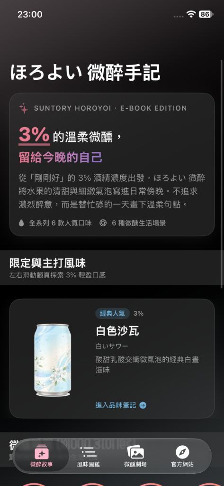
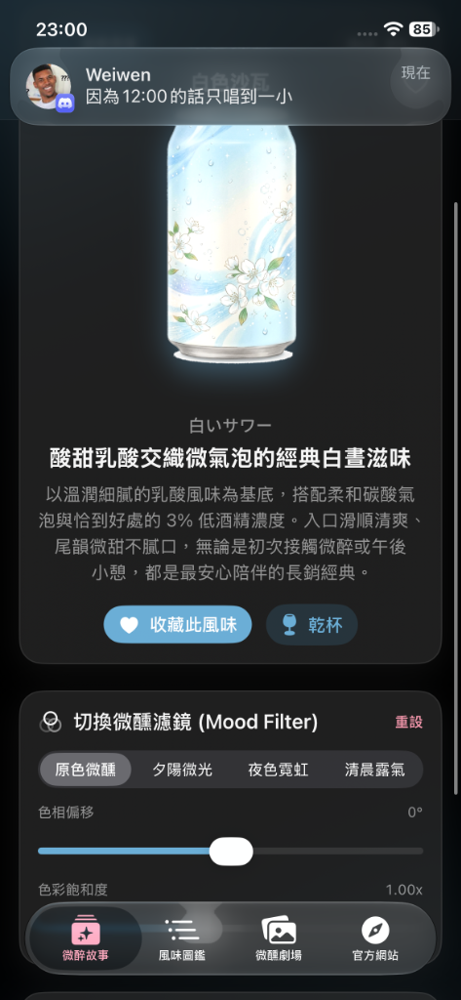

# ほろよい 微醉手記 — Suntory Horoyoi Interactive eBook App

一款以三得利（Suntory）低酒精氣泡飲 **「ほろよい（微醉）」** 為主題打造的 SwiftUI 互動電子書 App，支援 **iPhone / iPad（iOS 27.0 / iPadOS 27.0）** 與 **淺色 / 深色模式（Light & Dark Mode）**。

> 「3% 的溫柔微醺，留給今晚的自己。」

---

## 📱 實機畫面展示 (Screenshots)

| Tab 1 · 微醉故事 | Detail · 風味筆記與濾鏡 | Tab 3 · 微醺寫真與影音 |
|:---:|:---:|:---:|
|  |  |  |

---

## ✨ 四大分頁與互動功能 (Features)

1. **Tab 1 — 微醉故事 (`ExploreView`)**
   - 使用 `LazyVStack(pinnedViews: [.sectionHeaders])` 打造置頂區塊標題與複合滾動排版。
   - **故事首圖卡**：結合 `Text` 插值多樣式文字（字重、漸層前景色與底線）與 `.ultraThinMaterial` 磨砂卡片。
   - **限定與主打風味輪播**：透過 `ScrollView(.horizontal)` + `.scrollTargetLayout()` + `.scrollTargetBehavior(.paging)` 實現流暢左右翻頁，點擊直接進入風味詳情頁。
   - **微醺時刻（Mood Stories）**：垂直頁面內嵌 IG 風格漸層圓環故事列（`scene_01` ~ `scene_06`），點擊開啟 [`SceneStorySheet`](HoroyoiApp/Modifiers/HoroyoiCardModifier.swift) 閱讀生活情境小語。
   - **今晚的下酒提案**：呈現 4 款超商與居酒屋零負擔搭餐建議。

2. **風味詳情與微醺濾鏡 (`FlavorDetailView`)**
   - **瓶身飄浮動畫**：使用 `.animation(.easeInOut(duration: 1.8).repeatForever(autoreverses: true), value: isFloating)` 呈現微氣泡輕盈漂浮感。
   - **SF Symbol 互動動效**：收藏與乾杯按鈕套用 `.symbolEffect(.bounce)`，季節／常態標籤搭配 `.symbolEffect(.pulse.byLayer, options: .repeat(.continuous))`。
   - **即時微醺濾鏡（Mood Filter）**：提供 4 組預設風格（原色微醺、夕陽微光、夜色霓虹、清晨露氣）及色相偏移（`.hueRotation`）、飽和度（`.saturation`）、對比度（`.contrast(1.1)`）與光暈陰影即時預覽。
   - **侍酒師風味筆記轉場**：點擊「查看侍酒師風味筆記與下酒菜」，以 `withAnimation(.spring)` 搭配 `.transition(.asymmetric(insertion: .scale.combined(with: .opacity), removal: .opacity))` 展開甜潤度／酸爽度雷達與推薦下酒菜。

3. **Tab 2 — 全系列風味圖鑑 (`FlavorListView`)**
   - 直接使用 `List(HoroyoiData.flavors)` 消費 `Identifiable` 模型陣列，展示罐身去背縮圖、日文品名、`3% ABV` 徽章與 SF Symbols 甜度星等。

4. **Tab 3 — 微醺寫真與影音 (`GalleryAndMediaView`)**
   - **品牌形象微電影**：透過 `AVKit` 的 `VideoPlayer` 播放內建於 `Resources/` 的形象短片（`gemini_generated_video_331c824a.mp4`，亦支援 `horoyoi_cm.mp4`）。
   - **微醺寫真牆**：採用兩欄式 `LazyVGrid` 展示 6 張微醺生活寫真，點擊可開啟故事彈窗。
   - **官方線上畫報**：使用 `AsyncImage(url:)` 完整處理 `.empty`、`ProgressView`、`.success` 與 `.failure` 狀態。

5. **Tab 4 — 官方網站 (`BrandWebView`)**
   - `import WebKit` 直接使用 iOS 26/27 原生 SwiftUI `WebView(url:)` 元件瀏覽三得利微醉台灣官方網站，並支援手勢前後頁切換與外部 Safari 開啟。

---

## 🛠 技術規格與架構 (Tech Stack)

- **語言與部署目標**：Swift 6 / iOS 27.0 / iPadOS 27.0
- **UI 框架與原生 API**：
  - `NavigationStack` + `NavigationLink` 導覽架構（不使用已淘汰的 `NavigationView`）
  - 現代 `Tab(_:systemImage:)` + `.tabViewStyle(.sidebarAdaptable)`（iPhone 底部 Tab Bar / iPad 頂部列與可收合側邊欄）
  - 原生 `WebKit.WebView(url:)`（不使用 `UIViewRepresentable`）
  - `AVKit.VideoPlayer`、`AsyncImage`、自訂 `ViewModifier`（[`HoroyoiCardModifier`](HoroyoiApp/Modifiers/HoroyoiCardModifier.swift)）
  - 語意化色彩（`.primary`、`.secondary`、`.ultraThinMaterial`、自適應 `LaunchBackground`）完整支援淺色與深色模式

---

## 📂 專案目錄結構 (Project Structure)

```text
horoyoiapp/
├── README.md
├── HoroyoiApp.xcodeproj/
│   ├── project.pbxproj
│   └── xcshareddata/xcschemes/HoroyoiApp.xcscheme
└── HoroyoiApp/
    ├── HoroyoiApp.swift                         # App 進入點
    ├── Info.plist                               # UILaunchScreen 與顯示名稱設定
    ├── Models/
    │   ├── HoroyoiModels.swift                  # FlavorItem, ScenePhoto, FoodPairing (Identifiable & Hashable)
    │   └── HoroyoiData.swift                    # 6 款風味、6 組生活場景、搭餐提案與官方圖片網址
    ├── Modifiers/
    │   └── HoroyoiCardModifier.swift            # horoyoiCardStyle()、Hex 色碼擴充、圖片佔位器與故事彈窗
    ├── Views/
    │   ├── MainTabView.swift                    # Sidebar Adaptable 根部 TabView
    │   ├── ExploreView.swift                    # Tab 1: 首頁電子書、置頂標題、分頁輪播與 Mood Stories
    │   ├── FlavorDetailView.swift               # 風味詳情頁（飄浮動畫、SymbolEffect、濾鏡、筆記轉場）
    │   ├── FlavorListView.swift                 # Tab 2: 全系列風味列表
    │   ├── GalleryAndMediaView.swift            # Tab 3: AVKit 影片、LazyVGrid 寫真牆、AsyncImage
    │   └── BrandWebView.swift                   # Tab 4: 原生 SwiftUI WebView
    ├── Resources/
    │   ├── Assets.xcassets/                     # AppIcon, LaunchBackground, launch_logo, can_*, scene_*
    │   └── gemini_generated_video_331c824a.mp4  # 品牌形象短片 (1280x720, 10s)
    └── docs/
        ├── index.html                           # 響應式產品介紹 Landing Page（已排除於 App Bundle 外）
        └── screenshots/
            ├── explore.png
            ├── detail.png
            └── gallery.png
```

---

## 🚀 本機執行方式 (Getting Started)

1. 以 **Xcode 27.0+** 開啟 `HoroyoiApp.xcodeproj`：
   ```bash
   open HoroyoiApp.xcodeproj
   ```
2. 選擇 **iPhone** 或 **iPad（iOS 27.0 / iPadOS 27.0）** 模擬器後按下 `Cmd + R` 建置並啟動。
3. 瀏覽 Landing Page 可直接開啟 [`HoroyoiApp/docs/index.html`](HoroyoiApp/docs/index.html)。

---

> 提醒您：禁止酒駕・未滿十八歲請勿飲酒。本專案為 SwiftUI 互動電子書學習與展示作品。
